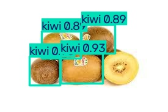
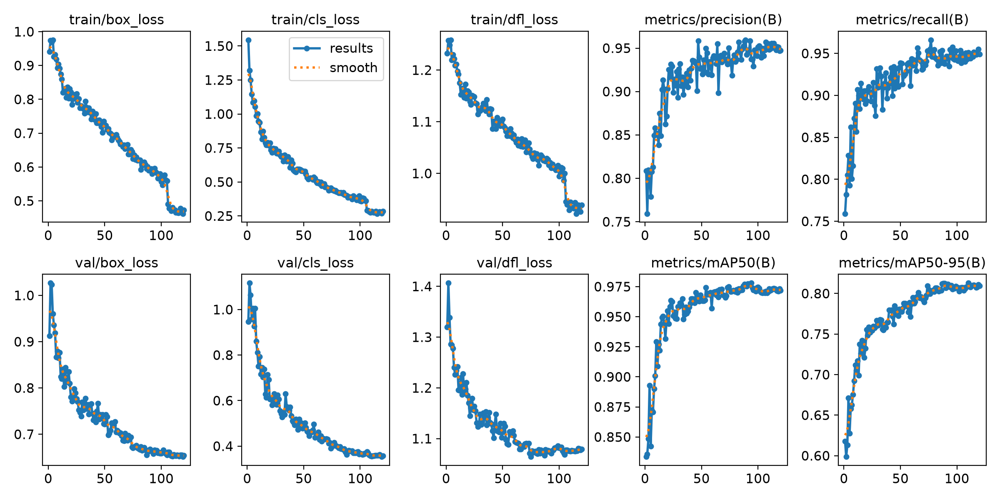

# 六类水果目标检测

基于 Ultralytics YOLO11s 的水果目标检测项目，支持图片、视频和摄像头检测。使用官方 COCO 预训练权重初始化，在六类水果数据集上微调，提供训练代码、模型权重和 Tkinter 桌面界面。

识别类别：苹果（apple）、橙子（orange）、香蕉（banana）、猕猴桃（kiwi）、柠檬（lemon）、草莓（strawberry）。

## 检测效果

下图来自测试集中的展示样本，展示不等同于完整测试集评估。



更多原图和对应结果见 [examples](examples)。

## 功能

- 图片检测，显示检测框、类别、置信度，保存结果图片。
- 视频和摄像头检测，视频结果保存为 MP4。
- 调整置信度阈值，查看当前画面各类水果数量。
- 数据集类别筛选、标注抽查、训练和验证。

视频中的累计检测框是各帧检测数量之和，同一个水果可能重复出现；没有实现跨帧去重或传送带过线计数。

## 安装与运行

建议 Python 3.11。Windows 安装 Python 时勾选 Tkinter/tcl-tk 和添加到 PATH。

```powershell
git clone https://github.com/Duuuuiiii/yolo-fruit-detection.git
cd yolo-fruit-detection
python -m venv .venv
.venv\Scripts\python.exe -m pip install -r requirements.txt
.venv\Scripts\python.exe app.py
```

安装完成后也可以双击 `start.bat`。该脚本会优先使用项目中的 `.venv`，出现错误时保留窗口以显示错误信息。

模型随仓库提供，默认位置为 `models/best.pt`。也可设置环境变量 `FRUIT_MODEL_PATH` 指定其他权重。推理自动使用可用设备；没有 NVIDIA GPU 也可以使用 CPU，速度会慢一些。GPU 需要安装与显卡驱动匹配的 [PyTorch](https://pytorch.org/get-started/locally/) 版本。

在 macOS/Linux 上创建并激活虚拟环境后，执行 `pip install -r requirements.txt` 和 `python app.py`。Linux 若缺少 Tkinter，需要通过系统包管理器安装 `python3-tk`。

### 命令行检测

```powershell
.venv\Scripts\python.exe predict.py --source examples/images --conf 0.35
.venv\Scripts\python.exe predict.py --source your_video.mp4 --conf 0.50
```

检测结果默认保存到 `results/predict`，可通过 `--output` 指定目录。摄像头：`--source 0 --show`。

## 训练与数据

数据来源：[school / fruit detection](https://universe.roboflow.com/school-qmdcx/fruit-detection-aubry)，通过 Roboflow 导出 YOLO 格式数据。上游许可为 [CC BY 4.0](https://creativecommons.org/licenses/by/4.0/)，数据署名和样本说明见 [ATTRIBUTION.md](ATTRIBUTION.md)。

原始导出包含 1,077 张图片。筛选六类后，训练集 744 张、验证集 216 张、测试集 112 张。类别 ID 顺序为 `apple, orange, banana, kiwi, lemon, strawberry`。

训练脚本移除包含其余类别标注的图片，重新映射类别 ID，并生成 24 张随机样本的标注预览。预览检查只是辅助，不能保证所有标注正确。没有把整个数据集放进仓库。

1. 将原始 YOLO 格式导出 ZIP 放入 `input/`。
2. 执行 `python train.py --prepare-only`，检查 `audit_preview.jpg` 和 `audit_report.txt`。
3. 执行 `python train.py --device 0` 开始训练；无 GPU 时可用 `--device cpu`。

已有 `raw_export/` 或 `dataset_6class/` 时，脚本拒绝覆盖；再次训练可直接使用已生成的数据：

```powershell
python train.py --data dataset_6class/data.yaml --device 0
python evaluate.py --data dataset_6class/data.yaml --split val
python evaluate.py --data dataset_6class/data.yaml --split test
```

主要训练参数：YOLO11s、120 epochs、imgsz=640、batch=4、AdamW、lr0=0.001、cos_lr=True、patience=30、close_mosaic=15、seed=209、amp=False。参数见 [docs/training/config.yaml](docs/training/config.yaml)。从官方预训练权重微调，不是随机初始化训练。首次训练会下载官方权重。

## 已有训练结果

发布的 `best.pt` 在 **216 张验证图片、600 个目标**上的训练结束验证结果：

| 指标 | 结果 |
| --- | ---: |
| Precision | 95.1% |
| Recall | 95.2% |
| mAP50 | 97.3% |
| mAP50–95 | 81.3% |

训练过程单轮最高 mAP50 为 97.8%（第 94 轮），它与发布模型的最终验证结果不是同一个数。`best.pt` 是框架按验证 fitness 选择的检查点，并不只看 mAP50。

训练记录和曲线见 [docs/training](docs/training)。上述指标来自验证集，不能代表任意真实场景或测试集上的性能；完整测试集指标需运行 `evaluate.py --split test` 得到。遮挡、复杂背景、强光和不同拍摄设备都可能影响结果。



## 项目结构

```text
app.py               桌面检测界面
predict.py           命令行检测
train.py             数据准备、标注抽查、训练
evaluate.py          验证或测试集评估
models/best.pt       六类水果模型
examples/            10 组原图与检测结果
docs/training/       训练参数、记录和曲线
```

## 许可与来源

本项目代码按 [AGPL-3.0](LICENSE) 发布，使用 [Ultralytics](https://github.com/ultralytics/ultralytics)。水果模型由本项目使用其官方预训练权重进行微调；模型使用也需遵守上游适用许可。数据集及展示样本的来源和许可见 [ATTRIBUTION.md](ATTRIBUTION.md)。
